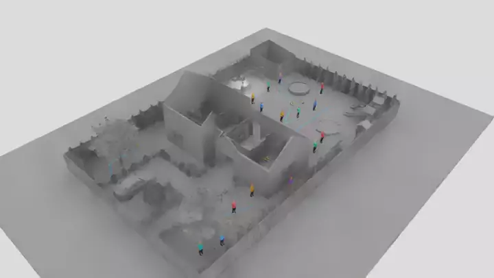
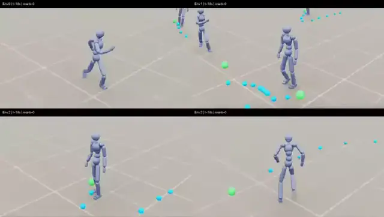
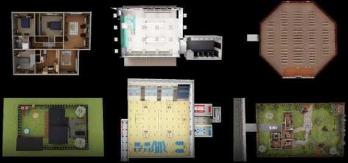
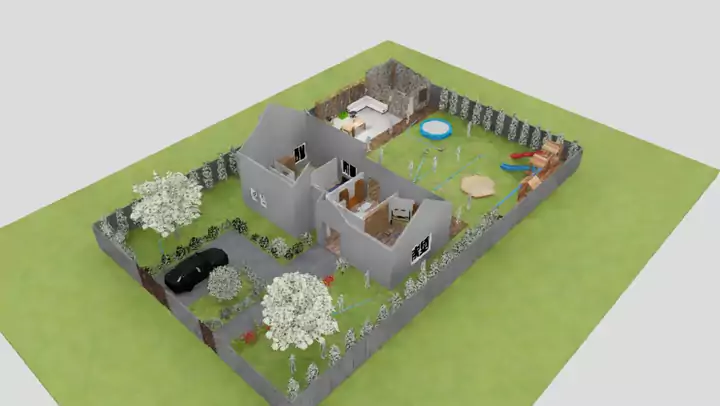
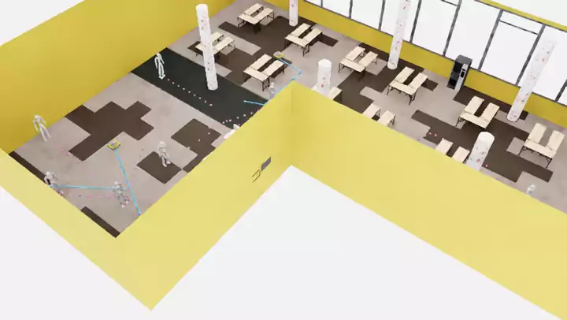
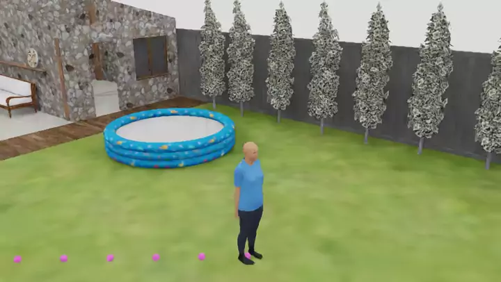
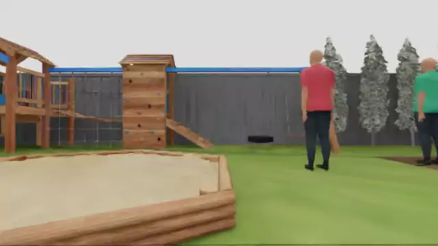
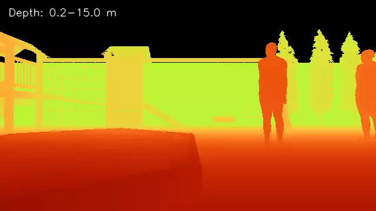

# NavIsaacLab

[](https://developer.nvidia.com/isaac/sim)
[](https://isaac-sim.github.io/IsaacLab/)
[](https://www.python.org/)
[](LICENCE)

[](https://arxiv.org/abs/2606.26265)
[](https://broln7.github.io/NavIsaacLab-web/)
[](https://huggingface.co/datasets/hill77/NavIsaacLab_assets)

NavIsaacLab is an Isaac Lab simulator for robot navigation among physically
simulated pedestrians. Pedestrians use a PACER-style trajectory task trained
with [MimicKit](https://github.com/xbpeng/MimicKit), SMPL motion data, AMP style
rewards, and an explicit left-right symmetry loss. The trained policy controls
simulated pedestrians during navigation-policy training and robot-centric RGB-D
data collection.



## Highlights

- **AMP-trained pedestrians.** Physically simulated SMPL humanoids learn
  natural locomotion from motion data with MimicKit AMP, PACER-style trajectory
  tracking, symmetry regularization, and optional clothed-human rendering.
- **Rich scene assets.** Cross-scale, photorealistic indoor and outdoor scenes
  are built with Infinigen and OmniGibson assets and paired with occupancy maps
  for planning, collision checks, and reproducible evaluation.
- **Scalable navigation workflows.** Vectorized environments support
  large-scale parallel policy training and evaluation as well as synchronized
  robot-centric RGB-D, state, action, and episode-data collection.

## Tested stack

| Component | Version |
| --- | --- |
| Ubuntu | 22.04 |
| Python | 3.11 |
| Isaac Sim | 5.1.0 |
| Isaac Lab | 2.3.1 |
| PyTorch | 2.7.0 + CUDA 12.8 |
| Stable-Baselines3 | 2.9.0 |

The repository assumes a working NVIDIA driver and an Isaac Lab Python
environment. `cuda:0` is the default device in the provided AMP and recording
entry points; override it with `--device` when needed.

## Installation

Install Isaac Sim 5.1 and Isaac Lab 2.3.1 using the official Isaac Lab setup,
then activate that Python environment before running the commands below.

```bash
git clone <repository-url> navisaaclab
cd navisaaclab

./isaaclab.sh -p -m pip install --upgrade pip
./isaaclab.sh -p -m pip install -e "exts/socnav_sim[amp,data]"
./isaaclab.sh -p -m pip install -r requirements-mimickit-amp.txt
```

Fetch the reviewed MimicKit revision pinned in
`third_party/mimickit.lock.json`:

```bash
./isaaclab.sh -p scripts/mimickit_amp/fetch.py
```

Download the official MimicKit data archive from the link in MimicKit's README,
then install its SMPL XML/USD assets without extracting unrelated files:

```bash
./isaaclab.sh -p scripts/mimickit_amp/install_assets.py \
  /path/to/MimicKit_Data.zip
```

## Data setup

Download the data bundle from
[Hugging Face](https://huggingface.co/datasets/hill77/NavIsaacLab_assets).
See [data/README.md](data/README.md) for extraction, directory layout, required
assets, and optional SMPL source-model setup.

## AMP locomotion

The locomotion implementation extends MimicKit. AMP trains the physical SMPL
skeleton; clothed meshes are a navigation-time render layer and do not change
policy inputs, physics, rewards, or checkpoints.

Start a pure AMP run:

```bash
./isaaclab.sh -p scripts/mimickit_amp/run.py \
  --mode train --amp_only --headless \
  --num_envs 4096 --max_iterations 5000 --device cuda:0
```

To use only the two official walk/run motions, add
`--motion_file data/mimickit/official_smpl/motions.yaml` to the pure AMP command.

Start the PACER-style trajectory-tracking task from scratch:

```bash
./isaaclab.sh -p scripts/mimickit_amp/run.py \
  --mode train \
  --env_config data/cfg/mimickit_amp/env_tracking.yaml \
  --headless --num_envs 12288 --max_iterations 8000 --device cuda:0
```

The tuned presets are stored in `data/cfg/mimickit_amp/`: `agent.yaml` controls
the learner and symmetry loss, while `env_tracking.yaml` controls the tracking
task and power penalty. Training runs are saved under `logs/mimickit/smpl-amp/`.

Play a checkpoint and record a four-view video:

```bash
./isaaclab.sh -p scripts/mimickit_amp/run.py \
  --mode play --checkpoint /path/to/run/int_models/model_0000002800.pt \
  --num_envs 4 --steps 600 --headless --video --device cuda:0 \
  --out_dir logs/mimickit/playback-2800
```

Keep the checkpoint's original `params/` directory alongside its run. Playback
restores the saved settings; the command prints the video output location.
Export the pedestrian actor for navigation with:

```bash
./isaaclab.sh -p scripts/mimickit_amp/export_policy.py \
  /path/to/run/int_models/model_0000002800.pt \
  --output data/checkpoints/policy.pth
```

The data bundle already contains an exported pedestrian actor. Export again
only when replacing it with a newly trained policy. To view training metrics:

```bash
./isaaclab.sh -p -m tensorboard.main --logdir logs/mimickit/smpl-amp --port 6006
```



## Photorealistic scene assets

NavIsaacLab includes a collection of indoor and outdoor environments created
with Infinigen and OmniGibson assets and generation workflows. The collection
spans room-scale interiors, complete buildings, warehouses, public spaces, and
large outdoor environments, providing photorealistic scenes across multiple
spatial scales. Navigation scenes are paired with occupancy maps for global
planning, collision checks, pedestrian trajectories, and reproducible policy
evaluation.

<p align="center">
  
</p>

## Social-navigation benchmarks

The initial NavIsaacLab release provides two social-navigation methods, CADRL
and DRL-VO; additional methods may be released as they are needed.

| Method | Policy input and role | Entry points |
| --- | --- | --- |
| **CADRL** | State-based multi-agent collision avoidance with AMP pedestrians | `scripts/policy_training/cadrl/` |
| **DRL-VO** | Deep reinforcement learning with pedestrian, lidar, and sub-goal observations | `scripts/policy_training/drl_vo/` |

CADRL is the benchmark used for the included scene demonstrations and has been
validated in the current Isaac Sim 5.1 setup. DRL-VO shares the same assets and
navigation utilities; its new Jackal scene integration has passed CPU checks
and still needs validation with the RTX lidar in simulation.

### CADRL policy training

Train a CADRL policy in scene 12:

```bash
SOCNAV_CONFIG="$PWD/data/cfg/cadrl_scene12.yaml" \
./isaaclab.sh -p scripts/policy_training/cadrl/train.py \
  --headless --num_envs 32 --num_robots 8 \
  --max_iterations 1000 --device cuda:0
```

Add `--realistic_pedestrians` when clothed TailorNet pedestrians are required.
Without the flag, the lightweight articulated SMPL humanoids are rendered.

| Scene 12 | Scene 35 |
| --- | --- |
|  |  |

### DRL-VO policy training

DRL-VO uses the same Jackal, AMP pedestrians, scene assets, map-based paths,
goal and collision rewards, and reset conditions as CADRL. Its policy takes
pedestrian velocity grids, RTX planar-lidar history, and local subgoals through
the DRL-VO CNN. Scene 12 and scene 35 are registered as
`Isaac-Drlvo-Scene12` and `Isaac-Drlvo-Scene35`; `Isaac-Drlvo` aliases scene 12.

Train from scratch without a navigation checkpoint:

```bash
SOCNAV_CONFIG="$PWD/data/cfg/drlvo_scene12.yaml" \
./isaaclab.sh -p scripts/policy_training/drl_vo/train.py \
  --headless --num_envs 16 --num_robots 4 \
  --max_iterations 1000 --device cuda:0
```

Use `scripts/policy_training/drl_vo/inference.py --checkpoint /path/to/model.zip`
to play a DRL-VO checkpoint. Add `--headless --video --video_length 300` to
record a 10-second clip. RTX lidar requires rendering even when video is off,
so these entry points enable rendering automatically. The included public
demonstration videos were recorded with CADRL.

## Robot-centric RGB-D collection

TailorNet can render the same AMP-controlled physical humanoid as a clothed
pedestrian for visual-navigation experiments:



Record synchronized RGB, metric depth, calibration, robot state, actions, goals,
and reset flags:

```bash
SOCNAV_CONFIG="$PWD/data/cfg/egonav_scene12.yaml" \
./isaaclab.sh -p scripts/data_collection/collect_egocentric_rgbd.py \
  --headless --num_envs 8 --steps 300 \
  --realistic_pedestrians --device cuda:0
```

The command prints the output directory. Each run contains
`robot_first_person.webm`, `calibration.json`, `frames.jsonl`, and optional
`rgb/` and `depth/` frame directories. Add `--video_only` when individual PNG
frames are unnecessary.

| RGB | Depth preview |
| --- | --- |
|  |  |

See the [CADRL guide](docs/cadrl-examples.md),
[EgoNav data guide](docs/egonav-data-collection.md), and
[TailorNet rendering guide](docs/tailornet-pedestrians.md) for additional
commands and configuration details.

## Acknowledgements

**AMP locomotion.** We thank
[MimicKit](https://github.com/xbpeng/MimicKit),
[PACER](https://github.com/nv-tlabs/pacer),
[AMASS](https://amass.is.tue.mpg.de/), and
[SMPL](https://smpl.is.tue.mpg.de/) for the foundations and inspiration behind
the AMP locomotion pipeline.

**Scene generation.** We thank
[Infinigen](https://github.com/princeton-vl/infinigen) and
[OmniGibson](https://github.com/StanfordVL/BEHAVIOR-1K) for the tools, assets,
and workflows that supported scene generation.

**Clothed-human rendering.** We thank
[TailorNet](https://github.com/chaitanya100100/TailorNet) for enabling the
clothed SMPL pedestrian rendering pipeline.

NavIsaacLab is built on [Isaac Lab](https://github.com/isaac-sim/IsaacLab).
Please cite the corresponding projects and datasets when using their code,
assets, models, or data.

## License

Repository code is released under the [Apache License 2.0](LICENCE). Third-party
code, datasets, models, motions, and scene assets remain subject to their own
licenses.
